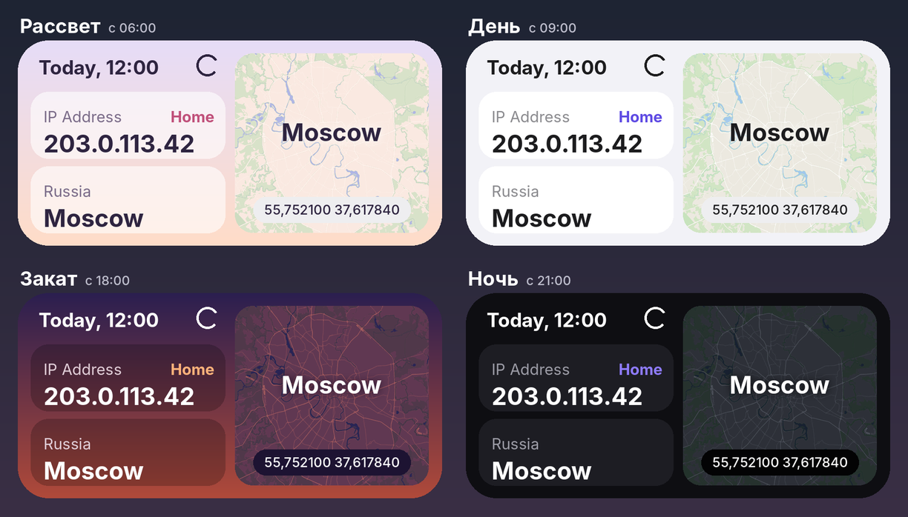

# My IP — виджет для Android

Виджет на главный экран: публичный IP-адрес, страна с флагом, город и карта с координатами.
Удобно проверить одним взглядом, работает ли VPN и через какой маршрут идёт трафик.

Макет: режимы Рассвет, День, Закат и Ночь (IP из документационного диапазона).

## Скачать

**[MyIPWidget.apk](https://github.com/forsetiqa/MyIPWidget/releases/download/latest/MyIPWidget.apk)** — последняя сборка, Android 8.0 и новее.

1. Открой ссылку на телефоне и установи APK (Android попросит разрешить установку из браузера).
2. Запусти **My IP** — он сразу определит адрес.
3. Добавь виджет: кнопкой в приложении или долгим нажатием на экран → Виджеты → My IP.

Новые сборки ставятся поверх старых, настройки сохраняются.

## Возможности

- **Два виджета:** 4×2 — время обновления, IP, страна, город и карта; 2×2 — то же без карты.
- **Четыре режима оформления** — Рассвет, День, Закат, Ночь. Режим выбирается по часам телефона,
  а не по стране IP, поэтому через VPN оформление не «уезжает» в другой часовой пояс.
  Время начала каждого режима настраивается, любой режим можно закрепить.
- **Выбор сервиса определения IP:** Яндекс (по умолчанию), ipwho.is, 2ip.io, Cloudflare, ipify или свой URL.
- **Названия для своих адресов:** строка `203.0.113.42 = Home` — и рядом с IP в виджете появится «Home».
- **Автообновление:** каждые 30 минут, при смене сети (Wi-Fi ↔ мобильная, включение VPN) и по кнопке ↻.
  Пока идёт запрос, IP плавно мигает, а в заголовке бегут точки.
- **Без рекламы и аналитики:** настройки хранятся только на телефоне, запросы уходят лишь к сервисам IP и карт.

## Как это работает

- **IP** запрашивается у выбранного сервиса. **Местоположение** — отдельным запросом по самому адресу:
  ipwho.is → ipapi.co → ipinfo.io (следующий — если предыдущий не ответил).
- **Раздельная маршрутизация** (podkop, VPN по доменам): виджет показывает IP того маршрута,
  через который идёт домен выбранного сервиса. Сменив сервис, можно проверить разные маршруты.
- **Карта** собирается из тайлов Esri Dark Gray Canvas и перекрашивается под текущий режим.
  Если Esri недоступен — тайлы OpenStreetMap. Тайлы кэшируются на 30 дней.
- **Смена режима** происходит по будильнику на ближайшую границу (с точностью до ~10 минут),
  а также сразу при переводе часов или смене часового пояса.

## Сборка

Чистый Java, без AndroidX и сторонних библиотек; minSdk 26, compileSdk 35.

- **GitHub Actions:** каждый push в `main` собирает APK и выкладывает его в релиз
  [`latest`](https://github.com/forsetiqa/MyIPWidget/releases/tag/latest).
- **Локально:** `./gradlew assembleDebug` → `app/build/outputs/apk/debug/app-debug.apk`,
  или открыть папку в Android Studio и нажать Run.

Структура кода

| Файл | Что делает |
|---|---|
| `WidgetUpdater` | Обновление виджетов, анимация обновления, сборка `RemoteViews` |
| `IpFetcher`, `IpSource` | Запрос IP у выбранного сервиса и местоположения по IP |
| `MapRenderer` | Загрузка и перекраска тайлов, подпись города и координат |
| `Theme`, `Phase`, `ThemeClock` | Палитры режимов, расписание, будильник на смену режима |
| `NetworkWatcher`, `EventReceiver` | Реакция на смену сети, кнопку ↻, перезагрузку, перевод часов |
| `MainActivity` | Экран приложения и настройки |
| `Store` | Настройки и последний результат (`SharedPreferences`) |

## Данные и карты

Местоположение: [ipwho.is](https://ipwho.is), [ipapi.co](https://ipapi.co), [ipinfo.io](https://ipinfo.io).
Определение IP: [Яндекс.Интернетометр](https://yandex.ru/internet), [2ip.io](https://2ip.io),
[Cloudflare](https://www.cloudflare.com/cdn-cgi/trace), [ipify](https://www.ipify.org).
Карта: © Esri, HERE, Garmin; © [OpenStreetMap](https://www.openstreetmap.org/copyright) contributors.
